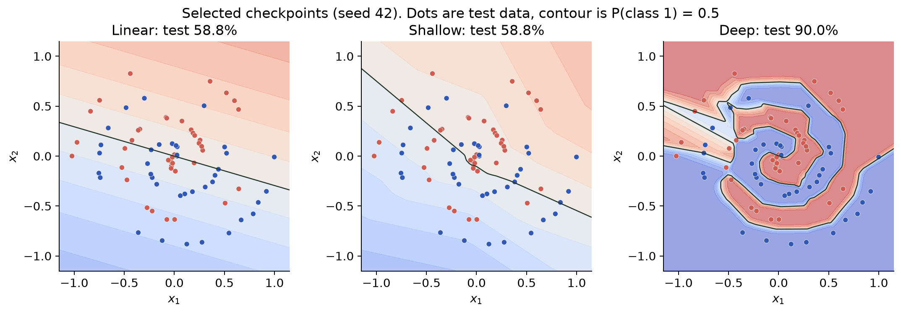
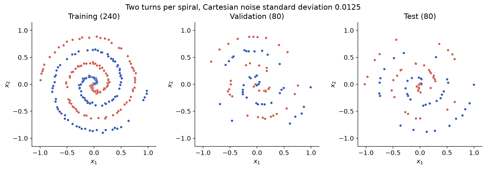
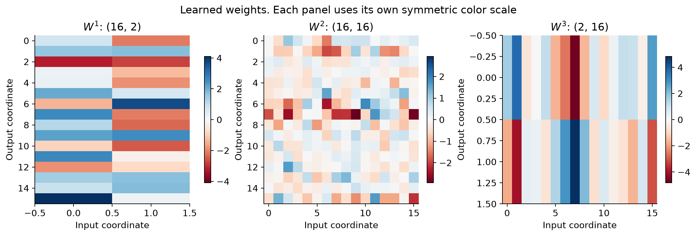
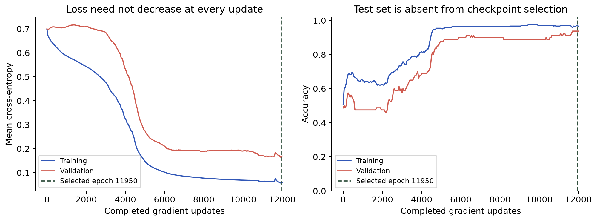
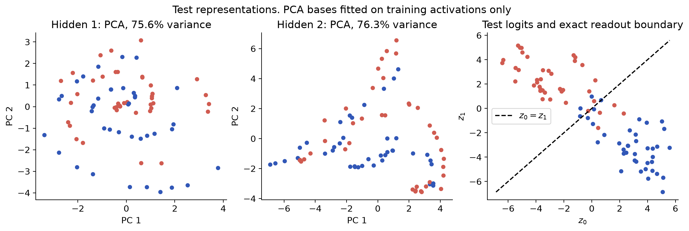
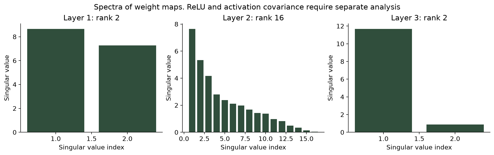

# Neural networks through matrix operations

Affine maps, backpropagation, PCA and SVD on two spirals

UE25MA242A: Mathematical Foundation for AI & Data Science | Mini-project | Reproducible NumPy implementation

Research question: How does adding ReLU to compositions of affine maps change a classifier's decision boundary, and what can matrix decompositions tell us about the learned maps?

We implement a 2-16-16-2 network with 354 trainable scalar parameters. We train on 240 synthetic points, select a checkpoint using 80 validation points, and evaluate on 80 separate test points. The primary run (initialization seed 42) classifies 72 of 80 test points correctly (90.00%).

The experiment includes a linear baseline and a network with one hidden layer. All models use explicit NumPy gradients. Finite differences independently check the derivatives. PCA visualizes hidden activations, and SVD provides weight spectra and a controlled rank truncation experiment.

Linear algebra supplies the matrix operations. Nonlinear activation, probability, differential calculus and optimization supply additional essential ingredients. This project demonstrates their interaction.



## 1. Inspiration, dataset and separation

The supplied problem sheet lists 14 applications. This project extends Project 10 (matrix transformations), Project 11 (PCA) and Project 14 (SVD compression). It is an inspired extension, rather than a literal implementation of a listed neural network problem. Confirm that the instructor accepts extensions before submission.

The confirmed course code is UE25MA242A, matching the supplied sheet's header. The adapted manual mixes Python and MATLAB syntax. We use verified NumPy syntax and cite its mathematical topics rather than copying its code.

For each class c in {0,1}, generate 200 points with theta uniformly spaced from 0 to 4*pi and radius theta/(4*pi). Add independent Cartesian Gaussian noise with standard deviation 0.0125 to each coordinate. A local random generator uses data seed 42. This creates two turns per arm, with opposite arms shifted by pi.

A stratified split with seed 2026 assigns 120/40/40 points per class to training/validation/test. We do not normalize these already bounded coordinates. Every sample is a column of X. Synthetic test points assess generalization to held-out points from this generator, not to real-world data.

For a two-class affine softmax classifier, equal class scores define a line. Three failed candidate lines alone would not prove nonseparability. Instead, our code records two intersecting within-class segments. Their intersection belongs to both class convex hulls. A strict affine separator would have to assign the same point opposite signs, which is impossible. This rules out perfect affine classification, but does not impose a 50% accuracy ceiling.

```text
x_c(theta) = (r*cos(theta+c*pi), r*sin(theta+c*pi))^T + epsilon
```

```text
epsilon ~ N(0, 0.0125^2 I_2),  r = theta/(4*pi)
```

```text
(w_1-w_0)^T x + (b_1-b_0) = 0
```



## 2. Forward propagation and dimensions

We use column-oriented samples and three trainable affine maps, with two ReLU hidden layers. A layer computes Z = WA + b*1^T. The bias makes the map affine. ReLU acts coordinate by coordinate, and the final layer uses softmax to convert logits into class probabilities.

Layer 1 has W1 in R^(16 x 2) and b1 in R^(16 x 1), giving 32+16=48 parameters. Layer 2 has W2 in R^(16 x 16) and b2 in R^(16 x 1), giving 256+16=272. Layer 3 has W3 in R^(2 x 16) and b3 in R^(2 x 1), giving 32+2=34. Total: 354 parameters, comprising 320 weights and 34 biases.

During training m=240, so Z1 and A1 have shape (16,240), Z2 and A2 have shape (16,240), and Z3 and P have shape (2,240). The same equations work with m=80 during evaluation. Broadcasting b across columns implements b*1^T.

Hidden weights use independent normal samples with variance 2/fan_in (He scaling). The output uses variance 1/fan_in. Biases start at zero. These are initialization heuristics based on approximate moment preservation, not guarantees about singular values or training stability.

If hidden activations are identities, composing affine layers gives another affine map, including an effective bias. ReLU breaks that collapse and produces a piecewise affine logit function. Within each fixed activation region, the binary decision boundary is a line segment. Many such regions can approximate a winding boundary. Softmax preserves which logit is largest.

```text
A0 = X,  Z_l = W_l A_(l-1) + b_l 1^T
```

```text
A1 = max(0,Z1),  A2 = max(0,Z2),  P = softmax(Z3)
```

```text
W_eff = W3 W2 W1
```

```text
b_eff = W3 W2 b1 + W3 b2 + b3
```



## 3. Loss and matrix backpropagation

The objective is mean cross-entropy over the training columns. Subtracting each column's largest logit before computing log-sum-exp avoids overflow. We compute loss from logits, so even extremely wrong predictions have a finite meaningful loss without clipping probabilities. Cross-entropy uses natural logarithms.

Let D_l denote the unaveraged logit error per sample. For softmax combined with cross-entropy, D3=P-Y. Hidden errors multiply by the next weight transpose and the elementwise ReLU mask. Parameter gradients average over m exactly once.

The transpose follows directly from the chain rule: the derivative of z_i with respect to a_j is W_ij, so the previous-layer gradient has component sum_i W_ij D_i. In Euclidean inner products, this is W^T D, the adjoint action. It is generally not the inverse of W.

D_l A_(l-1)^T is a sum of per-sample outer products. Each contribution has rank at most one, and the batch sum need not have rank one. The bias derivative sums errors over columns. Full-batch gradient descent subtracts learning_rate times each gradient from its parameter.

A centered finite-difference check on a small 2-4-3-2 model checked 35 scalar entries, skipping 0 ReLU kink crossings. Maximum absolute error: 9.89e-11. Separate tests cover an identity-activation model, stable extreme-logit loss, affine collapse with biases, splitting and spectral identities. ReLU is nondifferentiable at zero, where the implementation chooses derivative zero.

```text
L = -(1/m) sum_j sum_c Y_cj log(P_cj)
```

```text
D3 = P-Y
```

```text
D_l = (W_(l+1)^T D_(l+1)) * 1[Z_l > 0]
```

```text
grad(W_l) = D_l A_(l-1)^T / m
```

```text
grad(b_l) = D_l 1 / m
```

```text
theta_next = theta - 0.1 * grad(theta)
```

```text
finite_difference_i = (L(theta+h*e_i)-L(theta-h*e_i))/(2*h)
```

## 4. Evaluation and training evidence

We declare one data seed, one split seed, initialization seeds 42/43/44, 12,000 full-batch updates, and learning rate 0.1. Models share the split and update budget. Every 50 completed updates, we record training and validation loss and accuracy. We retain the checkpoint with smallest recorded validation loss. Test data never enter gradient computation or checkpoint selection.

Epoch 0 represents initialization. Metrics at epoch k describe parameters after exactly k updates. The selected checkpoint can precede the final epoch. Learning curves show the entire training trajectory, while reported evaluation uses the restored selected checkpoint. Loss need not decrease monotonically at this finite learning rate.

Primary results (seed 42) follow. Differences between the linear, shallow and deep models reflect both architecture and parameter count. The comparison is not controlled for equal capacity or equally optimized hyperparameters.

The main deep network gets 72/80 test predictions correct. An approximate Wilson 95% binomial interval is 81.49% to 94.85%. This interval describes sampling uncertainty only approximately because the radial grid is structured and not an independent random sample of every possible real-world input.

We also report all three initialization runs on the same split. The sample standard deviation describes initialization sensitivity only. Three seeds and one split do not characterize all sources of uncertainty. The main run is declared as seed 42, not whichever run scores highest on test data.

| Model | Parameters | Train | Validation | Test | Epoch |
| --- | --- | --- | --- | --- | --- |
| Linear | 6 | 50.00% | 45.00% | 58.75% | 4500 |
| Shallow | 82 | 57.50% | 51.25% | 58.75% | 50 |
| Deep | 354 | 97.08% | 93.75% | 90.00% | 11950 |

| Model | Seed 42 | Seed 43 | Seed 44 | Mean | Sample SD |
| --- | --- | --- | --- | --- | --- |
| Linear | 58.75% | 57.50% | 61.25% | 59.17% | 1.91 pp |
| Shallow | 58.75% | 61.25% | 55.00% | 58.33% | 3.15 pp |
| Deep | 90.00% | 92.50% | 78.75% | 87.08% | 7.32 pp |



## 5. Geometry and PCA projections

Hidden layers live in R^16, so a two-dimensional scatterplot cannot display the entire representation. For each hidden layer, we center the training activation matrix H, compute its thin SVD, and use the first two left singular vectors as a PCA basis. We project test activations using that same training mean and basis.

The first two components retain 75.58% of training activation variance for hidden layer 1 and 76.31% for hidden layer 2. The ratios use squared singular values of centered activations. These are activation variance ratios, distinct from weight-matrix energy fractions.

A PCA plot may discard classification-relevant directions. Overlap in two projected components does not prove the full hidden representation is inseparable, and visible separation does not prove perfect generalization. We label every plot as a projection and include its retained variance.

In the two-logit output plot, the decision boundary is z0=z1, a diagonal line. Each point's side predicts a class. This readout is linear in hidden coordinates while the input-space boundary is piecewise linear because of ReLU. The softmax probability surface can be smooth within regions, but it is not evidence of probability calibration.

ReLU can merge distinct inputs and kill coordinates. A learned hidden transformation therefore need not be invertible or a homeomorphism. Full rank of a weight matrix says nothing by itself about the number of active neurons on the dataset.

```text
H_centered = H_train - mean_train 1^T = U S V^T
```

```text
test_projection = U_two^T (H_test - mean_train 1^T)
```

```text
retained_variance = (s1^2+s2^2) / sum_i s_i^2
```



## 6. SVD, rank and Gram eigenvalues

For W in R^(p x q), thin SVD gives W=U diag(s) V^T with r=min(p,q) singular values. The columns of U and V are orthonormal on their retained subspaces. They encode changes of orthonormal basis, possibly involving reflections. SVD factors are not unique, for example because paired singular vectors can change sign.

Singular values measure directional amplification of a weight map before its activation. Squared singular values are the nonzero eigenvalues of W^T W. If q>r, the Gram matrix also contains q-r structural zeros. We compare eigvalsh(W^T W) with this correctly zero-padded spectrum and check SVD reconstruction independently.

A full-row-rank 2 x 16 output map has a 14-dimensional input nullspace. Its two returned singular values can have a modest ratio, even though the map cannot be inverted on all of R^16. We therefore label the ratio s_max/s_min as conditioning on the nonzero singular spectrum. Rank does not imply an orthogonal projection or prevent information loss.

Weight conditioning describes anisotropy of each affine map. It does not establish noise removal, gradient stability, neuron activity or probability calibration. The network Jacobian also depends on ReLU masks. A product of spectral norms bounds its operator norm, but such a bound alone does not show that gradients stayed away from zero.

Spectral diagnostics below refer to the seed 42 selected deep checkpoint. Every value comes from saved parameter arrays.

```text
W = U diag(s) V^T
```

```text
eigenvalues(W^T W) = {s_i^2} plus structural zeros
```

```text
rank(W) + nullity(W) = number of input coordinates
```

| Weight | Shape | Rank | Input nullity | s_max / s_min |
| --- | --- | --- | --- | --- |
| W1 | 16 x 2 | 2 | 0 | 1.190 |
| W2 | 16 x 16 | 16 | 0 | 197.537 |
| W3 | 2 x 16 | 2 | 14 | 13.287 |



## 7. Rank truncation and compression

Project 14 compresses images using SVD. We extend the same idea to the learned 16 x 16 hidden weight matrix W2. Keep only its k largest singular values, set W2_k=U_k diag(s_k) V_k^T, and keep every other weight and bias fixed. We evaluate the prescribed ranks 2,4,8,12,16 without retraining or choosing ranks from test accuracy.

The truncated SVD minimizes Frobenius error among matrices of rank at most k. The error equals the square root of the sum of discarded squared singular values. We numerically verify that identity. This is an approximation guarantee for W2, not for the whole classifier's predictions.

A factorized implementation could store B=U_k diag(s_k) and C=V_k^T, computing B(CA), using 32k scalar weight entries instead of 256. Rank 4 would halve this layer's weight storage, while rank 8 would save none. Bias storage remains unchanged. Our experiment materializes W2_k for direct comparison, so the saved model arrays themselves are not compressed factor files.

The table separates retained Frobenius energy from validation and test accuracy. Preserving most weight energy need not preserve all decision boundaries. Conversely, a change can sometimes improve an individual held-out score. Neither observation proves that training found a low-dimensional data manifold.

This experiment demonstrates a concrete application of SVD to model approximation. It gives a defensible link to the assigned material without claiming that the classifier is inherently low rank.

```text
W2_k = U_k diag(s_k) V_k^T
```

```text
||W2-W2_k||_F^2 = sum_(i>k) s_i^2
```

```text
energy_retained(k) = sum_(i<=k) s_i^2 / sum_i s_i^2
```

| Rank k | Energy | Factor entries | Validation | Test |
| --- | --- | --- | --- | --- |
| 2 | 64.47% | 64 | 56.25% | 65.00% |
| 4 | 83.11% | 128 | 68.75% | 77.50% |
| 8 | 95.61% | 256 | 96.25% | 90.00% |
| 12 | 99.72% | 384 | 92.50% | 90.00% |
| 16 | 100.00% | 512 | 93.75% | 90.00% |

## 8. Conclusions, limits and reproduction

The main experiment shows that this ReLU network learns a winding decision boundary using explicit matrix operations and gradients. The linear baseline has a limited boundary family. The shallow baseline's poor result under this particular width, learning rate and budget does not prove that every shallow network must fail. A sufficiently wide nonlinear hidden layer can be expressive, while successful optimization remains a separate question [3].

The dataset is small, balanced and synthetic. We used one split and three initializations, no systematic hyperparameter search and no real-world distribution shift. Near-origin noise can make class distinctions difficult. More data, additional predefined splits and a broader validation-only architecture study would strengthen the empirical comparison.

Reproduction from the project directory: create a virtual environment, install requirements.txt, then run python src/run_project.py. Run python -m unittest discover -s tests -v for numerical checks. The script regenerates dataset.npz, selected weights, CSV histories, metrics.json and figures. The notebook imports the same implementation, so it cannot diverge into a second unverified training algorithm.

The presentation, notebook and writeup read the generated metrics. Add your team names before submission. Original reference documents remain unchanged under the workspace references directory. The source ZIP is retained without unpacking unrelated image databases.

References below attribute the mathematical inspiration and implementation checks. The adapted lab manual contains formatting and programming errors, so it should not serve as an unquestioned Python reference.

1. [PES University, Mini-Project Problem Statements, supplied PDF, one page.](../../references/mini_project_problem_statements.pdf)

2. [Anna Zemlyanova, Applied projects for an introductory linear algebra class, supplied adapted manual. Projects 10, 11 and 14. CC BY-NC 4.0.](../../references/applied_linear_algebra_manual.pdf)

3. [Goodfellow, Bengio and Courville, Deep Learning (2016), Chapter 6, Deep Feedforward Networks.](https://www.deeplearningbook.org/contents/mlp.html)

4. [Stanford CS231n, Neural Networks Part 3, gradient checking.](https://cs231n.github.io/neural-networks-3/)

5. [NumPy documentation, numpy.linalg.svd.](https://numpy.org/doc/stable/reference/generated/numpy.linalg.svd.html)
